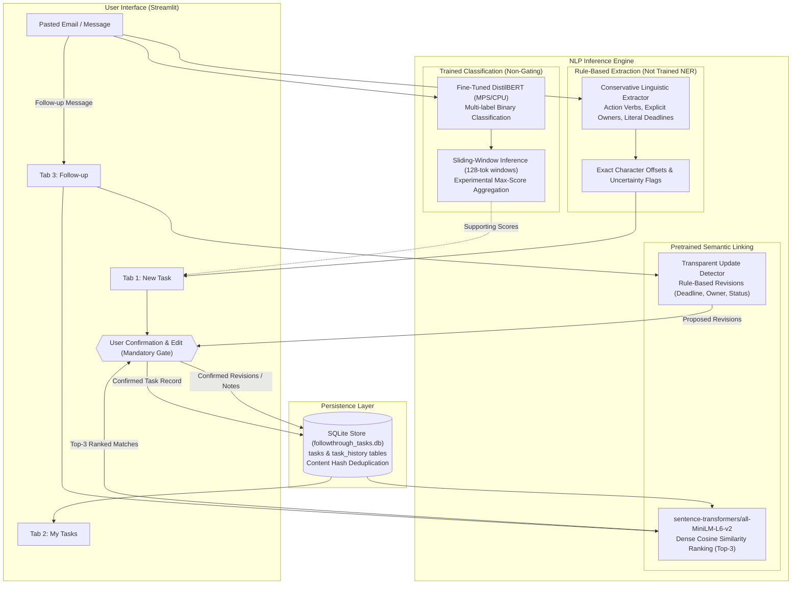

# FollowThrough: Evidence-Backed Conversational Task & State Tracking

**FollowThrough** turns emails and conversational message threads into evidence-backed tasks, then tracks user-confirmed revisions across follow-up messages.

> **Current Project Scope:**  
> **Email/message -> Evidence-backed task -> Saved task ledger -> Linked follow-up -> User-confirmed task update.**  
> *Note: FollowThrough focuses strictly on task extraction and evidence-grounded task tracking. It does not include calendar integration or automated reminders.*

Unlike simple action-item detectors that classify isolated sentences or unconstrained LLMs that hallucinate task parameters, FollowThrough enforces a strict, verifiable operational workflow:
- **Signal Classification:** Classifies Request and Commitment communicative acts to highlight actionable messages without gating user decisions.
- **Evidence-Backed Extraction:** Conservative linguistic rules extract action descriptions, explicit owners, literal deadlines, and exact character offsets.
- **Semantic Follow-up Linking:** Dense sentence embeddings (`sentence-transformers/all-MiniLM-L6-v2`) match follow-up messages to open tasks.
- **Revision Detection:** Flags candidate changes to deadlines, owners, and completion status.
- **Strict User Confirmation:** No task, state update, or revision is ever performed silently.

---

## Table of Contents
1. [Problem Statement & Core Principles](#problem-statement--core-principles)
2. [System Architecture](#system-architecture)
3. [Interactive Application Workflow](#interactive-application-workflow)
4. [Corpus & Dataset Scale (Enron v2)](#corpus--dataset-scale-enron-v2)
5. [NLP Models & Pipeline Components](#nlp-models--pipeline-components)
6. [Empirical Evaluation & Two-Model Comparison](#empirical-evaluation--two-model-comparison)
7. [Installation & Setup](#installation--setup)
8. [Reproducible Pipeline Scripts](#reproducible-pipeline-scripts)
9. [Repository Structure](#repository-structure)
10. [Limitations & Failure Modes](#limitations--failure-modes)
11. [AI-Assistance Disclosure](#ai-assistance-disclosure)

---

## Problem Statement & Core Principles

### The Problem: Obligation Drift in Conversational Threads
In asynchronous workplace collaboration (email, Slack, Microsoft Teams), projects advance through informal requests ("Can you draft the report by Wednesday?") and commitments ("I will have it ready"). However, conversational interactions are inherently dynamic:
1. **Shifting Deadlines:** A subsequent reply pushes the timeline ("Let's move this to Friday").
2. **Reassigned Owners:** A collaborator steps in ("Priya will handle this instead of Sam").
3. **Resolution & Cancellation:** A dependency clears or a task is superseded.

Conventional NLU solutions typically treat task extraction as single-sentence classification or generic Named Entity Recognition (NER). They suffer from two major flaws:
- **Context Blindness:** They fail to connect follow-up messages to previously established tasks, leading to duplicate or stale obligations.
- **Hallucination & Premature Automation:** Generative LLMs frequently hallucinate exact deadlines or invent unstated owners without user oversight, destroying user trust.

### Core System Principles
1. **Evidence-Grounded:** Every extracted task or suggested change must cite exact surface text and character offsets in the original email.
2. **Strict Human Confirmation:** The application **never** silently creates tasks, updates records, or completes obligations.
3. **Graceful Uncertainty:** Missing owners or ambiguous dates trigger explicit uncertainty flags (`UNCERTAIN_OWNER`, `UNCERTAIN_DEADLINE`) rather than speculative defaults.
4. **Transparent Component Separation:** Rule-based extraction is explicitly distinguished from trained classification and pretrained semantic linking.

---

## System Architecture

FollowThrough consists of three decoupled layers: an interactive Streamlit UI, an NLP Inference Engine, and a Persistence layer.



---

## Interactive Application Workflow

The Streamlit web application (`app.py`) is organized into three clean workflows:

### Tab 1: New Task
- **Message Input:** Paste an email, thread segment, or meeting transcript.
- **Analyze:** Click "Analyze & Extract Tasks".
- **Supporting Classifier Scores:** Displays Request/Commitment probability scores as non-gating advisory signals (supporting both standard 128-token mode and full-message sliding-window mode).
- **Suggested Task Fields (Editable):**
  - Action description.
  - Explicit owner (or flagged as `Unspecified`).
  - Literal deadline expression (e.g., `by Friday afternoon`).
  - Exact source evidence span and character offsets (`start_offset`, `end_offset`).
  - Uncertainty flags (`UNCERTAIN_DEADLINE`, `UNCERTAIN_OWNER`, `FORWARDED_CONTENT`).
- **Confirmation Gate:** Users must click **"Confirm & Save Task"** before any database commit.

### Tab 2: My Tasks
- **Clean Task Ledger:** View all active tasks with action description, owner, deadline, current status (`PENDING`, `COMPLETED`, `CANCELLED`), and last updated timestamp.
- **Expandable Evidence:** Expand to inspect the original evidence span and character offsets.
- **Expandable Change History:** View the full chronological revision audit trail (old value -> new value, evidence snippet, timestamp).
- **Manual Status Update:** Update status to completed or cancelled with mandatory supporting evidence and user confirmation.

### Tab 3: Follow-up
- **Follow-up Input:** Paste a reply or follow-up message (e.g., *"We have postponed the quarterly risk report to next Monday. Mike will review"*).
- **Semantic Ranking:** `all-MiniLM-L6-v2` ranks saved tasks by cosine similarity, displaying the Top-3 candidate tasks with similarity scores.
- **Task Selection:** User explicitly selects the confirmed matching task from a dropdown.
- **Proposed Supported Changes:** Transparent linguistic rules detect revisions:
  - `deadline_revised`: Detects postponed or shifted deadlines.
  - `owner_reassigned`: Detects new assignee declarations.
  - `marked_completed`: Detects completion signals (courtesies like *"Thanks"* are strictly excluded).
- **User Review & Confirmation:** User verifies the exact evidence snippet and clicks **"Confirm & Apply Update"** to commit the revision into the SQLite audit ledger while preserving prior state.

---

## Corpus & Dataset Scale (Enron v2)

FollowThrough is trained and evaluated on the active **Enron Subset v2** corpus:
- **Total Parsed Emails:** 100,000 raw email files.
- **Cleaned Sentences:** 1,442,694 sentences.
- **Cleaned Tokens:** 29,556,736 tokens.
- **Average Sentences per Email:** 14.43.
- **Thread Count:** 42,317 distinct threads (20,506 singletons, 21,811 multi-message threads).

### Manifest Creation & Hygiene
Mailbox folder redundancy was handled conservatively:
- **Canonical Key:** Normalized sender address + normalized subject (stripping `Re:`, `Fwd:`) + body SHA-256 hash.
- **Exclusion Audit:** 2,012 uninformative records excluded:
  - 1,370 empty or whitespace-only bodies.
  - 642 bodies under 10 characters.
- **Active Included Dataset:** **97,988 records**.

### Zero-Leakage Split Partitioning
To prevent duplicate groups and threaded conversations from appearing across training and evaluation sets, connected messages were grouped via **Disjoint-Set (Union-Find)**:
- Every thread ID and duplicate group ID shares an equivalence cluster.
- Partitioning was executed deterministically via MD5 hash buckets on the cluster root:
  - **Train Split:** 78,385 messages (79.99%)
  - **Validation Split:** 9,946 messages (10.15%)
  - **Test Split:** 9,657 messages (9.86%)
- Zero cluster or thread overlap crosses splits.

### Transparent Linguistic Weak Supervision
Weak labels were generated locally using transparent deterministic rules (no commercial LLM APIs used on private emails):
- **Request Rules:** Interrogative modals (`can you`, `could you`), polite imperatives (`please send`, `kindly provide`), deontic necessity markers (`need you to`), and request verb dependency structures.
- **Commitment Rules:** First-person future commissives (`I will`, `we will`, `I'll make sure`), explicit promises, and guarantees.
- **Exclusion Filters:** Negation (`will not`, `can't`), past actions (`already sent`), permission queries, and forwarded blocks were systematically filtered.
- **Distribution:**
  - Train: 35,141 Request (44.8%), 3,201 Commitment (4.1%)
  - Validation: 4,549 Request (45.7%), 392 Commitment (3.9%)
  - Test: 4,270 Request (44.2%), 363 Commitment (3.8%)

---

## NLP Models & Pipeline Components

FollowThrough coordinates four distinct NLP components:

| Component | Architecture / Model | Training Strategy | Role in System |
| :--- | :--- | :--- | :--- |
| **Model A: Baseline Classifier** | TF-IDF (10k n-grams) + Logistic Regression | Trained on 78k weak-labeled examples | Fast, lightweight request/commitment signal scoring |
| **Model B: Advanced Classifier** | `distilbert/distilbert-base-uncased` (2-output head) | Fine-tuned for 5,000 steps with BCEWithLogitsLoss on local MPS | Deep contextual sequence classification with sliding-window support |
| **Semantic Linking Engine** | `sentence-transformers/all-MiniLM-L6-v2` | Pretrained dense sentence embeddings | Dense cosine similarity ranking to link replies to prior open tasks |
| **Information Extraction Engine** | Rule-Based Linguistic Patterns (Regex & POS/DEP) | Deterministic linguistic rule engine | Conservative extraction of action verbs, literal deadlines, explicit owners, and offsets |

---

## Empirical Evaluation & Two-Model Comparison

### Critical Metric Disclaimer
> **Important Evaluation Notice:**  
> All reported classification metrics measure **weak-label agreement—not independently verified human ground-truth accuracy**.

### Held-Out Test Evaluation on All 9,657 Test Records
Both models were evaluated on the **identical held-out test split** ($N = 9,657$ records):

| Metric | Model A: TF-IDF + Logistic Reg | Model B: Fine-Tuned DistilBERT (5k steps) |
| :--- | :---: | :---: |
| **Test Examples Evaluated** | **9,657** | **9,657** |
| **Exact Match Accuracy** | **0.8801** | *0.7145* |
| **Hamming Loss** | **0.0632** | *0.1479* |
| **Macro-F1** | **0.6874** | *0.3656* |
| **Micro-F1** | **0.8715** | *0.7027* |
| **Request Precision** | **0.8996** | *0.6801* |
| **Request Recall** | **0.9169** | *0.7906* |
| **Request F1** | **0.9081** | *0.7312* |
| **Commitment Precision** | **0.4286** | *0.0000* |
| **Commitment Recall** | **0.5124** | *0.0000* |
| **Commitment F1** | **0.4668** | *0.0000* |
| **Model Size on Disk** | **8.4 MB** | **255.6 MB** |
| **Training Run** | **21.8 s** | **16.3 min (5,000 steps on MPS)** |

### Human Reference Evaluation Protocol
To benchmark extraction and linking independently of programmatic weak labels:
- **Test Human Review Sample:** A stratified sample of 50 held-out test messages is provided in [`data/annotations/test_human_review_sample.csv`](data/annotations/test_human_review_sample.csv) with human gold fields left blank pending manual review.
- **Pilot Review Sheet:** 38 pilot candidate instances are formatted in [`data/annotations/evaluation_review_sheet.csv`](data/annotations/evaluation_review_sheet.csv) for evaluating extraction span overlap and linking MRR.
- **Status:** Human extraction precision/recall and semantic linking MRR remain **pending human annotation**. No scores are fabricated.

---

## Installation & Setup

### 1. Prerequisites
- macOS (Apple Silicon MPS supported) or Linux (x86_64 / CUDA).
- Python 3.10 to 3.14.

### 2. Clone and Setup Environment
```bash
# Clone repository
git clone https://github.com/Rohita-G/FollowThrough.git
cd FollowThrough

# Create virtual environment
python3 -m venv .venv
source .venv/bin/activate

# Install dependencies
pip install -r requirements.txt
```

### 3. Launch Interactive Application
```bash
streamlit run app.py
```
Open your browser to `http://localhost:8501`.

---

## Reproducible Pipeline Scripts

### 1. Rebuild Full Corpus Manifest & Weak Labels
```bash
python scripts/build_full_corpus_manifest.py
```

### 2. Train and Evaluate TF-IDF Baseline (Model A)
```bash
python scripts/train_full_tfidf.py
```

### 3. Fine-Tune DistilBERT Model (Model B)
```bash
python scripts/train_full_distilbert.py --max_steps 5000 --save_every 1000
```

### 4. Evaluate DistilBERT on All 9,657 Test Records
```bash
python scripts/evaluate_full_distilbert.py
```

### 5. Benchmark Training Steps
```bash
python scripts/benchmark_training_steps.py
```

### 6. Run Workflow Verification Suite
```bash
python scripts/verify_end_to_end_workflow.py
python tests/test_task_workflow.py
```

---

## Repository Structure

```text
FollowThrough/
├── app.py [Interactive 3-tab Streamlit application: New Task, My Tasks, and Follow-up]
├── requirements.txt [Pinned project dependencies: PyTorch, Transformers, Streamlit, Scikit-learn, etc.]
├── README.md [Complete project documentation and reproducible benchmark report]
├── .gitignore [Rules preventing data dumps, model binaries, SQLite DBs, and tokens from entering Git]
├── .gitattributes [Line-ending and text normalization configuration]
├── followthrough_core/
│   ├── classifier.py [Multi-label classification inference supporting TF-IDF and fine-tuned DistilBERT]
│   ├── long_message_classifier.py [Sliding-window tokenization handler for long messages with overlap]
│   ├── task_extractor.py [Rule-based linguistic extractor identifying actions, explicit owners, literal deadlines, and offsets]
│   ├── followup_linker.py [Dense semantic linking using all-MiniLM-L6-v2 and rule-based revision detector]
│   ├── task_store.py [SQLite persistence engine managing tasks, deduplication hashes, and audit history]
│   └── calendar_sync.py [Preserved legacy calendar module pending user deletion decision]
├── scripts/
│   ├── build_full_corpus_manifest.py [100k Enron manifest compiler with Disjoint-Set cluster splitting and weak supervision]
│   ├── train_full_tfidf.py [Baseline TF-IDF + Logistic Regression training and evaluation script]
│   ├── train_full_distilbert.py [DistilBERT fine-tuning script with MPS streaming and resumable checkpoints]
│   ├── evaluate_full_distilbert.py [Evaluates fine-tuned DistilBERT on all 9,657 test records]
│   ├── benchmark_training_steps.py [100-step runtime benchmark script]
│   ├── create_test_human_review_file.py [Held-out test split sampler creating blank human gold review files]
│   ├── evaluate_nlp_pipeline.py [Pipeline evaluation runner computing extraction F1 and linking MRR]
│   ├── parse_enron_subset_v2.py [Parser cleaning raw Enron maildirs and stripping quotes]
│   ├── build_threads_v2.py [Message thread reconstructor]
│   └── verify_end_to_end_workflow.py [End-to-end integration verification test script]
├── docs/
│   ├── FINAL_REPORT_IEEE.md [Standard IEEE-format final report with full methodologies, parameters, and two-model evaluation]
│   ├── PRESENTATION_SLIDES.md [10–15 minute presentation deck outline and live demo script]
│   ├── architecture_diagram.md [Mermaid system architecture and data/training pipeline diagrams]
│   ├── AI_ASSISTANCE_DISCLOSURE.md [Academic disclosure of AI coding assistance and deterministic weak labeling]
│   ├── annotation_guidelines.md [Annotation guidelines for human labelers]
│   ├── annotation_schema_v1.md [Schema definition for task extraction and classification labels]
│   ├── DECISIONS.md [Architectural decision log tracking scope, deduplication rules, and verification constraints]
│   └── PLAN.md [Capstone milestone planning and delivery roadmap]
├── tests/
│   ├── test_task_workflow.py [Unit tests for offset accuracy, persistence, and semantic ranking]
│   └── test_long_message_and_calendar.py [Preserved tests for sliding-window token inference; calendar tests marked legacy]
└── data/annotations/
    ├── test_human_review_sample.csv [50 held-out test messages with blank human gold reference fields]
    └── evaluation_review_sheet.csv [Pilot task extraction and linking evaluation review sheet]
```

---

## Limitations & Failure Modes

1. **Formulaic Politeness:** Routine email closings (*"Please let me know if you need anything else"*) often trigger request rules despite lacking concrete task content.
2. **Deictic Temporal Anaphora:** Relative deadlines (*"by tomorrow afternoon"*) depend on message timestamps and user context.
3. **Commitment Sparsity:** Commissive acts represent only ~4% of workplace messages; detecting commitments without high false positive rates remains an open research challenge.
4. **Weak-Label Noise:** Metrics evaluate alignment with programmatic heuristics; imperfect heuristic rules inevitably bound the upper performance ceiling of supervised models.

---

## AI-Assistance Disclosure

In accordance with academic integrity guidelines:
- **Coding Assistance:** Generative AI tools were used for code scaffolding, regular expression prototyping, SQLite schema drafting, and Streamlit component layouts.
- **Data & Supervised Labels:** The full 100,000-message corpus weak labels were generated strictly via **deterministic, transparent local Python rule functions**, without transmitting corporate email data to external commercial LLM APIs.
- **Human Gold Reference:** All human gold evaluation sheets retain blank target fields pending manual review; no synthetic human scores have been fabricated.
- Full details are documented in [`docs/AI_ASSISTANCE_DISCLOSURE.md`](docs/AI_ASSISTANCE_DISCLOSURE.md).

---

## License
This project is licensed under the MIT License - see the LICENSE file for details.