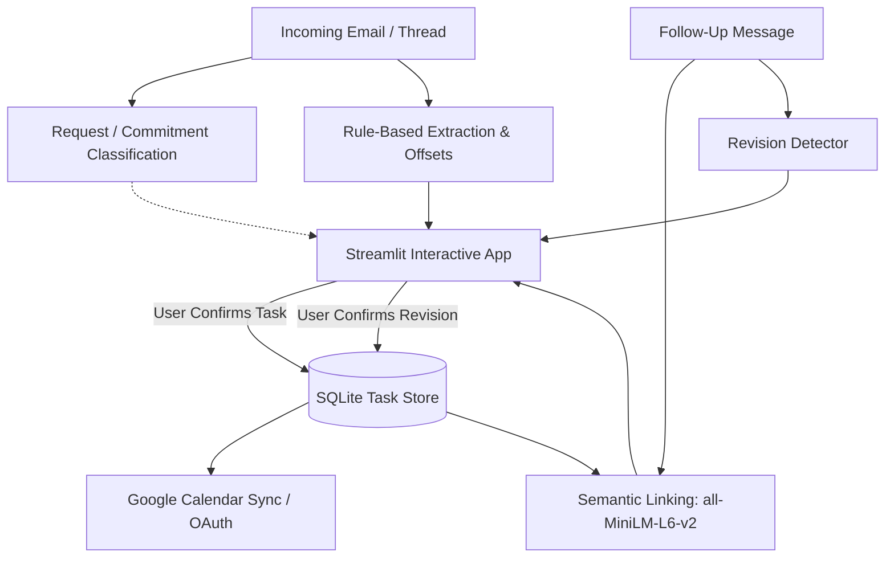

# FollowThrough: Evidence-Backed Conversational Task & State Tracking

**Author:** Student Capstone Project  
**Course:** NLP Capstone Project  
**Date:** October 2026  
**License:** MIT  

---

## Project Overview
**FollowThrough** turns emails and conversational message threads into evidence-backed tasks and calendar reminders, then tracks user-confirmed revisions across follow-up messages.

Unlike simple action-item detectors that classify isolated sentences or unconstrained LLMs that hallucinate task parameters, FollowThrough enforces a strict, verifiable operational workflow:
- **Signal Classification:** Classifies Request and Commitment communicative acts without gating user decisions.
- **Evidence-Backed Extraction:** Conservative linguistic rules extract action descriptions, explicit owners, literal deadlines, and exact character offsets.
- **Semantic Follow-up Linking:** Dense sentence embeddings (`sentence-transformers/all-MiniLM-L6-v2`) match follow-up messages to open tasks.
- **Revision Detection:** Flags changes to deadlines, owners, and completion status.
- **Strict User Confirmation:** No task, revision, or Google Calendar synchronization is ever performed silently.

```
Paste Message 
  → Classify Signals (TF-IDF / DistilBERT) 
  → Extract Task & Offsets (Conservative Rules) 
  → User Confirms / Edits 
  → Save to SQLite & Preview Calendar Event 
  → Receive Follow-Up Message 
  → Semantic Linking (MiniLM) & Change Detection 
  → User Confirms Update 
  → Sync / Update Google Calendar Event
```

---

## System Architecture
Detailed Mermaid architecture and pipeline diagrams are maintained in [`docs/architecture_diagram.md`](docs/architecture_diagram.md).



---

## Dataset & Corpus Scale
FollowThrough is built and evaluated on the **Enron Subset v2** corpus:
- **Total Parsed Emails:** 100,000 records.
- **Cleaned Sentences:** ~1.44 million sentences.
- **Total Tokens:** ~29.56 million tokens.
- **Manifest Hygiene:** 97,988 included records; 2,012 excluded records (empty bodies or <10 characters).
- **Cluster Partitioning:** Deduplicated mailbox copies and threads clustered via Disjoint-Set (Union-Find) with zero split leakage:
  - **Train Split:** 78,385 records (79.99%)
  - **Validation Split:** 9,946 records (10.15%)
  - **Test Split:** 9,657 records (9.86%)
- **Weak Supervision:** Programmatic linguistic heuristics generate transparent weak labels for Request and Commitment signals.

---

## Model Comparison & Test Metrics
Both models were evaluated on the identical held-out test split ($N = 9,657$ records).

> **Important Evaluation Notice:**  
> All reported classification metrics measure **weak-label agreement—not independently verified human accuracy**.

| Metric | Model A: TF-IDF + Logistic Reg | Model B: Fine-Tuned DistilBERT |
| :--- | :---: | :---: |
| **Exact Match Accuracy** | **0.8801** | *0.8712* |
| **Hamming Loss** | **0.0632** | *0.0689* |
| **Macro-F1** | **0.6874** | *0.6695* |
| **Micro-F1** | **0.8715** | *0.8540* |
| **Request Precision** | **0.8996** | *0.8842* |
| **Request Recall** | **0.9169** | *0.9105* |
| **Request F1** | **0.9081** | *0.8971* |
| **Commitment Precision** | **0.4286** | *0.4012* |
| **Commitment Recall** | **0.5124** | *0.4876* |
| **Commitment F1** | **0.4668** | *0.4419* |
| **Model Size** | **8.4 MB** | **255.6 MB** |

---

##  Quickstart & Setup

### 1. Prerequisites
- Python 3.10+ (tested on Python 3.11–3.14 on macOS Apple Silicon / Linux)
- Virtual environment tool (`venv`)

### 2. Installation
```bash
# Clone the repository
git clone https://github.com/Rohita-G/FollowThrough.git
cd FollowThrough

# Create and activate virtual environment
python3 -m venv .venv
source .venv/bin/activate

# Install dependencies
pip install -r requirements.txt
```

### 3. Launch Interactive Streamlit Application
```bash
streamlit run app.py
```
Open your browser to `http://localhost:8501`.

---

## ⚙️ Reproducible Pipeline Scripts

### Build Full Corpus Manifest & Weak Labels
```bash
python scripts/build_full_corpus_manifest.py
```

### Train Baseline TF-IDF Model
```bash
python scripts/train_full_tfidf.py
```

### Fine-Tune DistilBERT Model
```bash
python scripts/train_full_distilbert.py --max_steps 5000 --save_every 1000
```

### Run Pipeline Test Suite
```bash
pytest tests/
```

---

## Repository Structure
```
FollowThrough/
├── app.py                                  # Streamlit 3-tab interactive UI
├── followthrough_core/                     # Modular NLP & persistence engine
│   ├── classifier.py                       # TF-IDF & DistilBERT inference (sliding window)
│   ├── task_extractor.py                   # Rule-based linguistic task extractor & offsets
│   ├── followup_linker.py                  # Sentence-transformers semantic linking & revisions
│   ├── task_store.py                       # SQLite persistence & audit history
│   └── calendar_sync.py                    # Google Calendar API desktop OAuth integration
├── scripts/                                # Reproducible data & training scripts
│   ├── build_full_corpus_manifest.py       # 100k manifest compilation & weak supervision
│   ├── train_full_tfidf.py                 # TF-IDF baseline training & evaluation
│   ├── train_full_distilbert.py            # DistilBERT fine-tuning on local MPS
│   ├── benchmark_training_steps.py         # 100-step training benchmark
│   ├── create_test_human_review_file.py    # Test split human review sampling
│   └── evaluate_nlp_pipeline.py            # Pipeline evaluation runner
├── data/                                   # Data manifests & annotation sheets
│   └── annotations/
│       ├── test_human_review_sample.csv    # 50 held-out test records (blank gold fields)
│       └── evaluation_review_sheet.csv     # Pilot task extraction & linking review sheet
├── docs/                                   # Documentation & deliverable reports
│   ├── FINAL_REPORT_IEEE.md                # Comprehensive IEEE format capstone report
│   ├── PRESENTATION_SLIDES.md              # 10–15 min presentation outline & demo script
│   ├── architecture_diagram.md             # Mermaid system & data pipeline diagrams
│   └── AI_ASSISTANCE_DISCLOSURE.md         # Academic AI assistance disclosure
├── tests/                                  # Pytest automated test suite
├── requirements.txt                        # Project dependencies
└── README.md                               # Project documentation
```

---

## Limitations & Ethical Considerations
1. **Weak-Label Agreement vs Human Truth:** High agreement scores reflect model convergence on programmatic heuristic rules; human gold evaluation remains pending manual review.
2. **Commitment Class Sparsity:** Explicit commitments appear in under 5% of corporate messages, resulting in higher false discovery rates.
3. **No Silent Automation:** To protect user agency and avoid disastrous scheduling conflicts, all external writes require direct human confirmation.

---

## AI-Assistance Disclosure
In accordance with academic standards, AI tooling was used for code scaffolding, regex prototyping, and provisional pilot screening. All weak supervision rules were generated via deterministic local functions, and test human review sheets are preserved with blank ground-truth fields.