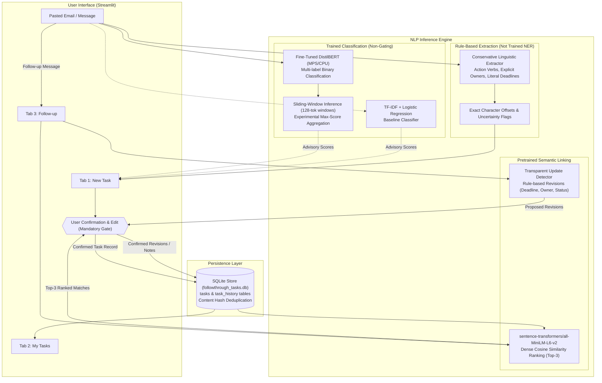
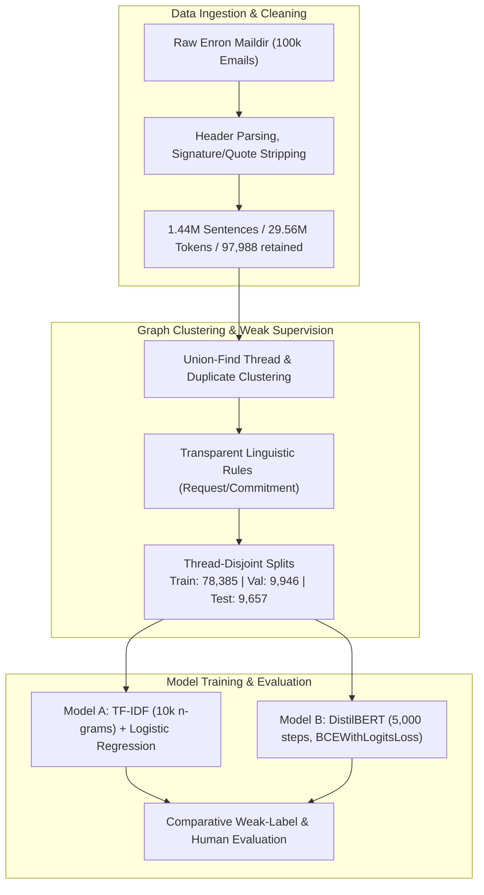

# FollowThrough System Architecture & Pipeline Design

FollowThrough is an end-to-end natural language processing (NLP) application that turns workplace emails and messages into **evidence-backed tasks**, links subsequent follow-up messages to those tasks using **dense semantic similarity**, and tracks user-confirmed state changes in an **audit ledger**.

---

## 1. High-Level Architectural Diagram

---

## 2. Core Architectural Principles

1. **Non-Gating Classifier Design:**
   Sequence classifiers provide advisory likelihood signals for Request and Commitment speech acts. They guide user attention but never gate or block candidate task extraction.
2. **Conservative Linguistic Extraction:**
   Rather than allowing a generative language model to hallucinate commitments or invent dates, task extraction uses explicit linguistic patterns anchored to modal verbs, proper names, and literal surface date expressions.
3. **Exact Character-Level Evidence Offsets:**
   Every extracted task retains `[start_offset:end_offset]`, enabling the user to verify the exact text slice in the original email.
4. **Dense Semantic Retrieval with Human Confirmation:**
   Follow-up messages are retrieved via `all-MiniLM-L6-v2` dense cosine similarity against open tasks. High similarity indicates semantic proximity, but user confirmation is strictly required to link the messages.
5. **Immutable Append-Only Audit Ledger:**
   The SQLite persistence store tracks every creation, reassignment, deadline revision, and status change in a dedicated `task_history` table.

---

## 3. Data Pipeline & Experiment Design

---

## 4. Component Summary

- **`followthrough_core/classifier.py`**: Clean object-oriented wrappers for DistilBERT and TF-IDF classifiers with unified prediction APIs.
- **`followthrough_core/long_message_classifier.py`**: Overlapping 128-token sliding-window inference with token-to-character offset tracking.
- **`followthrough_core/task_extractor.py`**: Rule-based linguistic candidate extraction with character offsets, uncertainty flags, and forwarded-text boundary detection.
- **`followthrough_core/followup_linker.py`**: Bi-encoder similarity ranking using `all-MiniLM-L6-v2` and conservative revision detection (deadline changes, reassignments, completions).
- **`followthrough_core/task_store.py`**: SQLite database managing deduplicated tasks and an append-only change history ledger.
- **`app/app.py`**: Interactive Streamlit application orchestrating the complete workflow.
