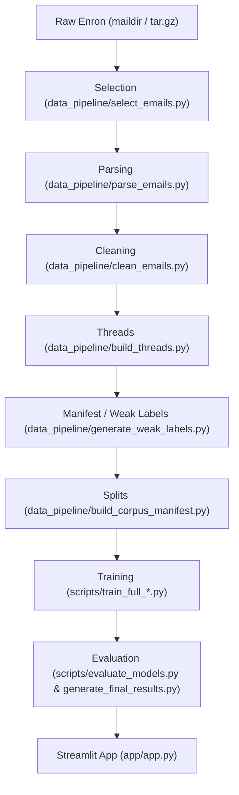

# Data Provenance & Lineage Specification

This document details the complete end-to-end data provenance for FollowThrough, from the public raw email archive to production inference inside the Streamlit web application.

---

## 1. End-to-End Pipeline Architecture

---

## 2. Pipeline Stages & Provenance Details

### 2.1 Data Source
- **Origin:** Carnegie Mellon University Enron Email Dataset (May 7, 2015 archive release).
- **Archive File:** `enron_mail_20150507.tar.gz` (~423 MB compressed, ~1.7 GB uncompressed maildir).
- **Format:** Native RFC 822 MIME text files across 150 user mailboxes.
- **Reproducibility:** Downloaded and extracted via `data_pipeline/download_enron.py`.

### 2.2 Email Selection
- **Module:** `data_pipeline/select_emails.py`
- **Logic:** Mailbox prioritization selects up to 100,000 files prioritizing core organizational participants (e.g. `kaminski-v`, `dasovich-j`, `farmer-d`, `shankman-j`) and their standard communication folders (`inbox`, `sent`, `_sent_mail`, `notes_inbox`).
- **Deterministic Sort:** Ensures consistent file ordering across runs.

### 2.3 Email Parsing
- **Module:** `data_pipeline/parse_emails.py`
- **Logic:** Python standard library `email.parser.BytesParser` extracts standard RFC 822 metadata:
  - `Message-ID`, `Date`, `From`, `To`, `Cc`, `Bcc`, `Subject`.
  - Body payload extracted with multipart handling and HTML entity stripping fallback.
  - Normalizes carriage returns (`\r\n` to `\n`).

### 2.4 Email Cleaning & Normalization
- **Module:** `data_pipeline/clean_emails.py`
- **Logic:**
  1. **Quotation Stripping:** Identifies reply headers (`-----Original Message-----`, `From: ... Sent: ...`, `wrote:`, and `>` line prefixes) and truncates trailing quotes to attribute commitments solely to the current message author.
  2. **Forwarded Content Handling:** Retains forwarded sections while flagging `has_forwarded_content` to account for attribution uncertainty.
  3. **Signature & Disclaimer Trimming:** Removes corporate disclaimers, automatic footers, confidentiality notices, and standard sign-offs.
  4. **Hashing & Identification:** Computes SHA256 content hashes of the normalized body for duplicate detection.
  5. **Exclusion Criteria:** Discards empty bodies or trivial fragments (<10 characters).

### 2.5 Thread Reconstruction
- **Module:** `data_pipeline/build_threads.py`
- **Logic:**
  - Normalizes subject lines by stripping iterative prefixes (`Re:`, `Fwd:`, `RE:`, `FW:`, `[EXTERNAL]`).
  - Groups related messages into conversation threads using normalized subject and participant overlap (`From`/`To`/`Cc`).
  - Sorts messages chronologically by parsed timestamp within each thread.

### 2.6 Weak Supervision (Pseudo-Label Generation)
- **Module:** `data_pipeline/generate_weak_labels.py`
- **Logic:** Applies deterministic, transparent linguistic regular expressions to label sentences and messages:
  - **Request Patterns:** Interrogatives and imperative constructions (`please send`, `could you provide`, `can you verify`, `let me know if`, `action required`, `by EOD`).
  - **Commitment Patterns:** First-person promissory expressions (`I will send`, `we will deliver`, `I'll follow up`, `I plan to`, `working on this now`).
  - **Negative Guards:** Filters out past tense reporting (`I sent it yesterday`, `we delivered last week`), third-party descriptions, and rhetorical statements.

### 2.7 Disjoint Graph Splits (No Leakage)
- **Module:** `data_pipeline/build_corpus_manifest.py`
- **Partitioning Algorithm:** DisjointSet / Union-Find graph clustering:
  - Nodes represent email records.
  - Edges connect emails sharing duplicate body content or conversation thread IDs.
  - Partitions complete connected components (~80% Train, ~10% Validation, ~10% Test) using seeded deterministic assignment (`seed=42`).
  - **Guarantee:** Strict **zero cluster leakage**; no email in the test set shares a thread or duplicate body with any training sample.
- **Corpus Summary:**
  - **Train Split:** 78,385 messages
  - **Validation Split:** 9,946 messages
  - **Test Split:** 9,657 messages
  - **Excluded:** 2,012 messages (empty bodies or <10 characters)

---

## 3. Downstream Consumers

### 3.1 Model Training
- `scripts/train_full_tfidf.py`: Trains 10,000 sublinear TF-IDF n-gram vectorizer + Logistic Regression classifiers for Request and Commitment detection.
- `scripts/train_full_distilbert.py`: Fine-tunes `distilbert-base-uncased` for 5,000 optimization steps using binary cross-entropy with logits.

### 3.2 Evaluation & Results Generation
- `scripts/evaluate_models.py`: Runs comparative evaluation on the test split.
- `scripts/evaluate_extraction_linking.py`: Validates task extraction and follow-up linking against human review sheets.
- `scripts/generate_final_results.py`: Generates the 8 canonical evaluation artifacts in `evaluation/results/`.

### 3.3 Interactive Streamlit Application
- `app/app.py`: Ingests raw input messages, classifies actionability via trained models, extracts tasks and evidence offsets, queries prior tasks via `all-MiniLM-L6-v2` semantic linking, and records confirmed changes in the SQLite task ledger.

---

## 4. Known Dataset Limitations

1. **Domain Bias:** The Enron corpus reflects early-2000s energy corporate email communication, containing domain-specific terminology, defunct file formats, and historical conversational conventions.
2. **Weak-Supervision Noise:** Rule-derived pseudo-labels provide scalable training signal across 97,988 records but contain inherent linguistic noise (e.g. idiomatic expressions resembling requests).
3. **Class Imbalance:** Natural corporate communications contain far fewer explicit forward-looking commitments (~3.8%) than requests (~44.2%), leading models fine-tuned without heavy loss reweighting to under-predict rare commitments.
4. **Human Verification Gap:** While programmatic metrics on held-out test splits are fully verified, human double-annotation metrics remain pending completion of the manual auditing protocol.
